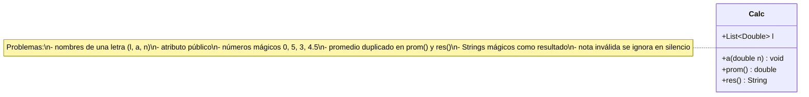
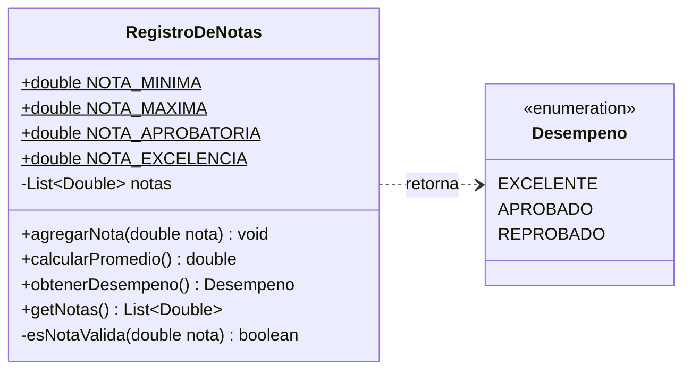
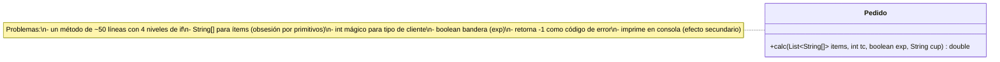
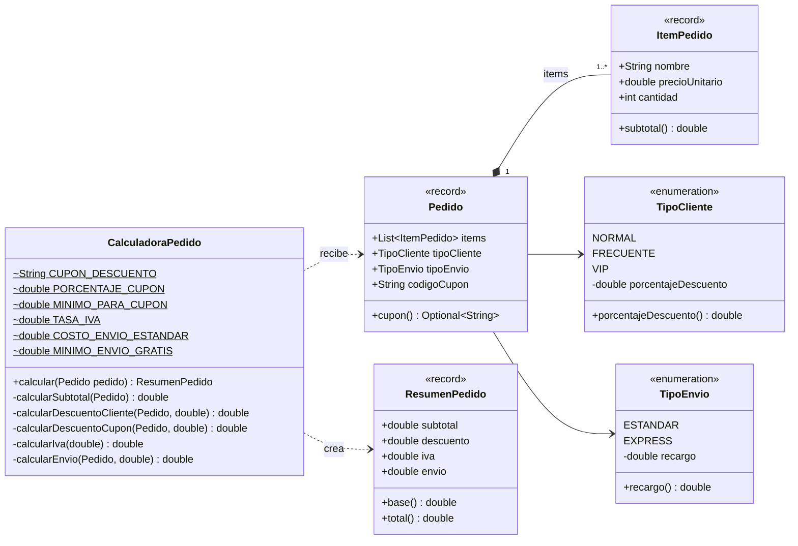
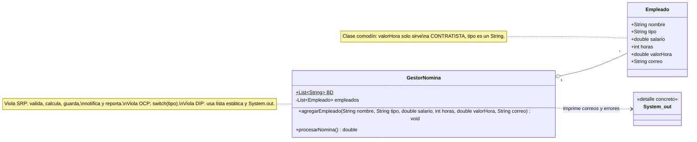
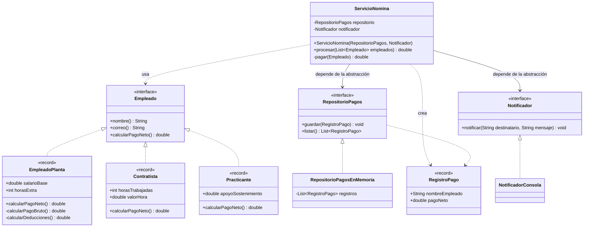

# Diagramas de clases — Ejercicios de Código Limpio

Paquete base: `com.udc.reut.cod.app.codigolimpioapp`

1. [Básico — sinsol](#diagrama-de-clases--basicosinsol)
2. [Básico — consol](#diagrama-de-clases--basicoconsol)
3. [Intermedio — sinsol](#diagrama-de-clases--intermediosinsol)
4. [Intermedio — consol](#diagrama-de-clases--intermedioconsol)
5. [Avanzado — sinsol](#diagrama-de-clases--avanzadosinsol)
6. [Avanzado — consol](#diagrama-de-clases--avanzadoconsol)

---

## Diagrama de clases — `basico.sinsol`

**Lectura del diagrama:** una sola clase con nombres crípticos. El atributo `l` es público (`+`),
por lo que cualquier cliente puede modificar las notas sin pasar por la validación de `a()`.

---

## Diagrama de clases — `basico.consol`

**Cambios frente a `sinsol`:**

| Antes (`Calc`)          | Después (`RegistroDeNotas`)               | Principio                      |
|-------------------------|-------------------------------------------|--------------------------------|
| `l` público             | `notas` privado + vista no modificable    | Encapsulamiento                |
| `a`, `prom`, `res`      | `agregarNota`, `calcularPromedio`, ...    | Nombres que revelan intención  |
| `0`, `5`, `3`, `4.5`    | `NOTA_MINIMA`, `NOTA_MAXIMA`, ...         | Sin números mágicos            |
| `"APROBADO"` (String)   | `Desempeno.APROBADO` (enum)               | Tipos en vez de Strings        |
| Promedio calculado 2 veces | `obtenerDesempeno()` usa `calcularPromedio()` | DRY                      |
| Nota inválida ignorada  | `IllegalArgumentException`                | Fallar rápido                  |

---

## Diagrama de clases — `intermedio.sinsol`

**Lectura del diagrama:** toda la lógica del negocio está escondida en un único método.
El diagrama no muestra ningún concepto del dominio (ítem, cliente, envío, resumen):
todos están "aplanados" en parámetros primitivos.

---

## Diagrama de clases — `intermedio.consol`

**Cambios frente a `sinsol`:**

| Antes                                  | Después                                   | Principio                          |
|----------------------------------------|-------------------------------------------|------------------------------------|
| Método `calc` de ~50 líneas            | 6 métodos privados pequeños               | Funciones pequeñas, una sola cosa  |
| `String[]{nombre, precio, cantidad}`   | `record ItemPedido`                       | Evitar obsesión por primitivos     |
| `int tc` (1, 2, 3)                     | `enum TipoCliente` con su descuento       | Reemplazar condicional por datos   |
| `boolean exp`                          | `enum TipoEnvio`                          | Sin argumentos bandera             |
| 4 parámetros sueltos                   | `record Pedido`                           | Objeto parámetro                   |
| `return -1`                            | Excepción en el constructor               | Excepciones, no códigos de error   |
| `System.out.println` dentro del cálculo | `ResumenPedido` devuelto al cliente      | Sin efectos secundarios            |
| `if` anidados                          | Cláusulas de guarda                       | Reducir anidamiento                |

---

## Diagrama de clases — `avanzado.sinsol`

**Lectura del diagrama:** `GestorNomina` concentra todas las responsabilidades y depende de
detalles concretos. `BD` está subrayado/estático (`$`): es estado global compartido.
Agregar un tipo de empleado nuevo obliga a modificar `procesarNomina()`.

---

## Diagrama de clases — `avanzado.consol`

**Cambios frente a `sinsol`:**

| Antes (`GestorNomina`)                 | Después                                              | Principio |
|----------------------------------------|------------------------------------------------------|-----------|
| Una clase hace 5 cosas                 | `ServicioNomina` orquesta; cálculo, persistencia y notificación separados | **S**RP |
| `switch (e.tipo)`                      | `Empleado.calcularPagoNeto()` polimórfico            | **O**CP   |
| `Empleado` comodín con campos inútiles | Un record por tipo, cada uno con solo sus datos      | **L**SP / **I**SP |
| `static List BD`, `System.out`         | Interfaces `RepositorioPagos` y `Notificador` inyectadas | **D**IP |
| Validación con `continue` silencioso   | Validación en el constructor del record              | Fallar rápido |

**Extensibilidad:** para agregar un `Pensionado` basta con crear una clase que implemente
`Empleado`. `ServicioNomina` no cambia (ver la prueba `agregarUnTipoNuevoNoRequiereModificarElServicio`).
